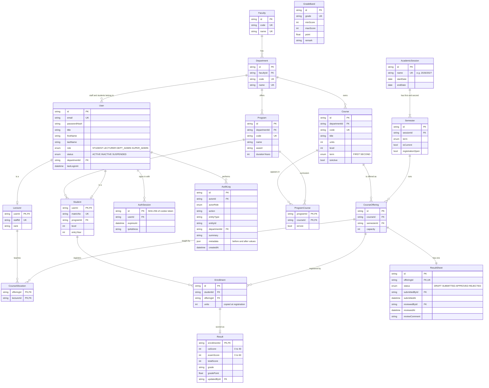

# Database design

PostgreSQL, managed with Prisma migrations. The schema source of truth is [`api/prisma/schema.prisma`](../api/prisma/schema.prisma); the generated SQL, including the extra constraints and the audit trigger, is in [`api/prisma/migrations`](../api/prisma/migrations).

## Entity relationship diagram

## Tables

| Table | Purpose |
|---|---|
| `Faculty`, `Department` | Academic structure. Every department belongs to one faculty. |
| `Program` | A degree programme (e.g. B.Sc. Computer Science) owned by a department. `durationYears` sets the highest level a student can reach. |
| `User` | One row per account for all four roles. Students, lecturers and department admins have a `departmentId`; super admins do not. |
| `Student`, `Lecturer` | Role-specific profile data, one-to-one with `User`. |
| `Course` | A course owned by a department, placed in the curriculum by `level` and `term`. |
| `ProgramCourse` | The curriculum: which courses each programme takes, and whether they are core or elective. A course can serve programmes in other departments (MTH 201 is taken by Computer Science students). |
| `AcademicSession`, `Semester` | Sessions such as 2026/2027, each with a first and second semester. One semester is current, and registration can be opened or closed on it. |
| `CourseOffering` | A course running in a specific semester. Registrations, lecturer allocations and the result sheet all hang off the offering, not the course, so history is kept per semester. |
| `CourseAllocation` | Which lecturers teach an offering. This is what limits a lecturer to their own courses. |
| `Enrollment` | A student's registration for an offering. `units` is copied from the course so later course edits do not change historical GPAs. |
| `ResultSheet` | One per offering. Its `status` drives the approval workflow and controls whether students can see the scores. |
| `Result` | CA and exam scores for one enrollment. Total, grade and grade point are stored when the scores are saved, so changing the grading scale does not rewrite approved results. |
| `GradeBand` | The configurable grading scale. |
| `AuthSession` | Server-side login sessions. Only a hash of the cookie token is stored. |
| `AuditLog` | Append-only record of every important action, with before/after values in `metadata`. |

## Integrity rules enforced by the database

These hold even if the API were bypassed.

| Rule | How |
|---|---|
| A student cannot register the same course twice in a semester | Unique index on `Enrollment(studentId, offeringId)`; an offering is unique per `(courseId, semesterId)` |
| One result sheet per offering, one result per registration | Unique `ResultSheet.offeringId`; `Result` keyed by `enrollmentId` |
| CA is 0–40 and exam is 0–60 | `CHECK` constraints on `Result` |
| Course units are 1–6; levels are 100–600 | `CHECK` constraints on `Course` and `Student` |
| Unique matric numbers, staff IDs, emails, course codes | Unique indexes |
| Records in use cannot be deleted | Foreign keys use `ON DELETE RESTRICT` (e.g. a department with students, a course that has been offered) |
| The audit log cannot be edited or deleted | A `BEFORE UPDATE OR DELETE` trigger on `AuditLog` raises an error |
