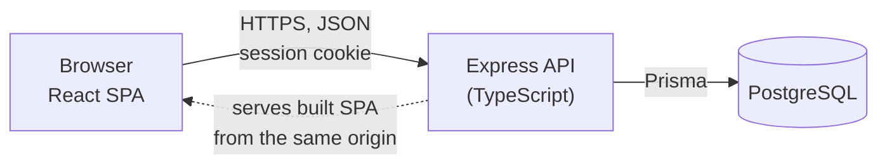
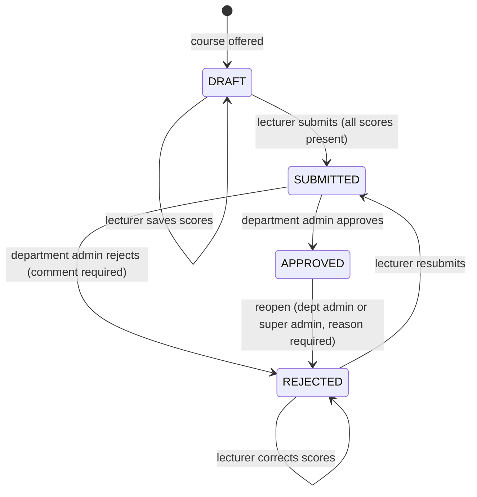

# UEMP technical documentation

This document covers the architecture, database structure, permission logic, security implementation and the main technical decisions. Setup instructions are in the [README](../README.md); the full database design and ER diagram are in [DATABASE.md](DATABASE.md).

## 1. Architecture



The app is a single deployable service. In production, Express serves the API under `/api` and the built React app for every other path. The frontend and API share one origin, so the session cookie is first-party, `SameSite=Lax` works without exceptions, and no CORS configuration is needed.

```
api/
  prisma/            schema, migrations, demo seed
  src/
    auth/            permission matrix, session store
    middleware/      authentication and permission checks
    lib/             validation, scoping, grading/GPA, audit, CSV
    services/        business rules: registration, result workflow, transcript, accounts
    routes/          one router per resource
  tests/             integration and unit tests (Vitest + Supertest)
web/
  src/
    components/      UI kit (from the design system), app shell, shared admin controls
    lib/             API client, auth context, types, formatting
    pages/           one folder per role: student, lecturer, admin, print
docs/
```

Route handlers stay thin: they validate input, check permissions, and call a service. The rules that matter for grading (registration, the result workflow and GPA) live in `api/src/services`, so they can be read and tested in one place.

## 2. Technology choices

| Choice | Why |
|---|---|
| TypeScript on both sides | One language, shared mental model, type errors caught before runtime. |
| Express 5 | Small and well understood. Version 5 forwards errors from async handlers, so there is no try/catch boilerplate in routes. |
| PostgreSQL | Relational data with real constraints: foreign keys, unique indexes, check constraints and triggers are all used. |
| Prisma 6 | Typed queries, readable schema, versioned SQL migrations. Raw SQL is used where Prisma has no equivalent (row locks, the audit trigger, check constraints). |
| Zod | Every request body and query string is validated, with field-level messages returned to the form. |
| React 19, Vite, React Router 7 | Fast builds and a standard SPA setup. |
| TanStack Query | Server state, caching and invalidation after mutations, without a global store. |
| Tailwind CSS 4 | The design tokens from the UI design are defined once as theme variables and used everywhere. |
| Server-side sessions, not JWT | See section 4. |

## 3. Roles

| Role | Scope | Home |
|---|---|---|
| Student | Own record only | `/student` |
| Lecturer | Courses they are allocated to | `/lecturer` |
| Department Admin | Own department | `/dept` |
| Super Admin | Whole university | `/admin` |

## 4. Authentication and session management

- Passwords are hashed with bcrypt (cost 12). Login compares against a dummy hash when the email does not exist, so response time does not reveal which emails are registered, and both cases return the same message.
- A successful login creates a random 256-bit token. The browser gets it in an `HttpOnly`, `SameSite=Lax` cookie (`Secure` in production). The database stores only its **SHA-256 hash** (`AuthSession.id`), so a leaked database row cannot be used as a cookie.
- Sessions expire after 8 hours (`SESSION_TTL_HOURS`).
- On every request the session is looked up and the user's status checked. **Suspending or deactivating a user takes effect immediately**: their sessions are deleted, and any request they make is treated as signed out. This immediate revocation is the main reason for server-side sessions over stateless JWTs.
- Logout deletes the session row. Changing a password signs out the user's other sessions.
- Login attempts are rate-limited (10 failures per 15 minutes per IP).
- After login the API returns the user's role, and the frontend redirects to that role's home. The frontend guard is for navigation only. Every API request is authorised again on the server.

## 5. Permission logic

Authorisation has two layers, and both run on the server for every request.

**Layer 1 – role permissions.** [`api/src/auth/permissions.ts`](../api/src/auth/permissions.ts) defines every permission once, with the roles that hold it and the scope they hold it at. Routes declare what they need:

```ts
resultsRouter.post('/sheets/:offeringId/approve', requirePermission('results.approve'), …)
```

A request without the permission gets `403`; an unauthenticated one gets `401`. The Roles & Permissions page in the app is generated from this same file, so the documentation cannot drift from the code.

**Layer 2 – data scope.** Holding a permission is not enough; the record must also be inside the user's scope:

| Scope | Enforced by |
|---|---|
| Own record (student) | The student id always comes from the session, never from the request. A student asking to drop someone else's registration gets `404`. |
| Assigned courses (lecturer) | `assertAllocated` checks `CourseAllocation` before any score sheet read or write. |
| Own department (department admin) | `departmentFilter` pins every list query to the admin's department, ignoring any `departmentId` in the request; `assertDepartmentAccess` checks single records; `targetDepartment` forces new records into the admin's department. |
| University-wide (super admin) | No department filter; may filter by department. |

Lecturers can only be allocated to courses in their own department, which is what stops a lecturer touching another department's results.

**Why permissions are fixed in code and not editable at runtime.** Several permissions encode rules from the brief, such as "only departmental administrators can approve results" or "students cannot modify grades". A runtime-editable permission table would let a configuration change break those rules, so permissions are fixed by policy. The Super Admin still manages *who* has each role: they can create users, change a staff member's role and department, and activate, deactivate or suspend accounts.

**Permission matrix**

| Permission | Student | Lecturer | Dept Admin | Super Admin |
|---|---|---|---|---|
| View/update own profile, register courses, view own approved results | Own | – | – | – |
| View assigned courses, enter and submit scores | – | Assigned | – | – |
| Manage students, lecturers, courses, programmes, offerings | – | – | Department | University |
| View registrations, result sheets, reports, audit log | – | – | Department | University |
| **Approve or reject results** | – | – | **Department** | – |
| Reopen approved results | – | – | Department | University |
| Manage faculties, departments, sessions, users, grading scale | – | – | – | University |

## 6. Business rules and where they are enforced

| # | Rule | Enforced in | Tested in |
|---|---|---|---|
| 1 | Students only register courses for their programme, level and the current semester | `services/registration.ts`: the offering must be in the current semester, at the student's level, in the student's programme curriculum, active, not full, and its result sheet still a draft | `workflows.test.ts` |
| 2 | No duplicate registration in a semester | Service check with a clear message, plus the unique index `Enrollment(studentId, offeringId)`, inside a serializable transaction | `workflows.test.ts` |
| 3 | Lecturers only enter results for assigned courses | `assertAllocated` in `services/results.ts` | `access.test.ts` |
| 4 | Results must be submitted before approval | Status machine in `reviewSheet`: approve requires `SUBMITTED` | `workflows.test.ts` |
| 5 | Only the department's admin approves its results | `results.approve` is held only by department admins, and `assertDepartmentAccess` checks the **course's** department. The super admin cannot approve. Nobody can review a sheet they submitted. | `workflows.test.ts` |
| 6 | Students only see approved results | `services/transcript.ts` includes scores only from `APPROVED` sheets | `workflows.test.ts` |
| 7 | Super admin has university-wide access | No department filter for the role | `access.test.ts` |
| 8 | Every submission, approval, rejection and modification is traceable | `audit()` is called inside the same transaction as each change; the table is append-only | `workflows.test.ts` |

Other rules: a maximum of 24 units per semester, and a course can only be offered in the semester its curriculum places it in. A student cannot drop a course once its scores have started, and registration can only be opened for the current semester.

## 7. Result workflow



- Scores can be edited only in `DRAFT` and `REJECTED`. Once submitted they are locked.
- Every state change uses a `SELECT … FOR UPDATE` lock on the sheet row inside a transaction, so a lecturer saving and an admin approving at the same moment cannot interleave.
- Students see a course's scores only while its sheet is `APPROVED`. Reopening hides them again until re-approval.

## 8. Grading and GPA

Default scale (editable by the super admin, validated for gaps and overlaps):

| Grade | Score | Point |
|---|---|---|
| A | 70–100 | 5 |
| B | 60–69 | 4 |
| C | 50–59 | 3 |
| D | 45–49 | 2 |
| E | 40–44 | 1 |
| F | 0–39 | 0 |

- Total = CA (max 40) + exam (max 60). The grade and point are computed when scores are saved and stored on the result.
- **GPA** for a semester = Σ(units × grade point) ÷ Σ units, over approved results, rounded to two decimal places.
- **CGPA** is the same calculation across all approved results to date.
- Class of degree: First Class ≥ 4.50, Second Class Upper ≥ 3.50, Second Class Lower ≥ 2.40, Third Class ≥ 1.50, Pass ≥ 1.00.
- Changing the scale does not rewrite results already saved, so approved transcripts stay stable. The new scale applies the next time scores are entered.

## 9. Audit trail

`AuditLog` records the actor, their role, the action, the affected record and department, a readable summary, the IP address and a JSON `metadata` field. When a lecturer saves scores, the metadata lists each student's CA and exam **before and after**. Entries are written in the same database transaction as the change, so a change cannot be committed without its log entry. A trigger rejects any `UPDATE` or `DELETE` on the table.

Department admins see their own department's log; the super admin sees everything, with filters and CSV export. Each result sheet's review page shows that sheet's history.

## 10. Security measures

| Area | Measure |
|---|---|
| Passwords | bcrypt, cost 12; minimum 8 characters with letters and numbers; new accounts get a random one-time password shown once to the admin |
| Sessions | Random 256-bit tokens, stored hashed; `HttpOnly`, `SameSite=Lax`, `Secure` cookies; 8-hour expiry; immediate revocation on suspend, deactivate or role change |
| CSRF | `SameSite=Lax` cookies plus a required `X-Requested-With` header on every state-changing request (browsers will not add it to a cross-site form post) |
| Brute force | Rate limit on login; identical response for unknown email and wrong password, with equal timing |
| Authorisation | Permission check and data scope on every endpoint; no client-supplied ids trusted for "own" data |
| Input | Zod validation on every body and query; database check constraints as a second line |
| Concurrency | Serializable transaction for registration; row locks on result sheets |
| Output | Security headers via Helmet (including a content security policy); `no-store` on API responses; spreadsheet formula injection neutralised in CSV exports; internal errors are logged, never returned to the client |

## 11. Error handling and user feedback

The API returns errors as `{ error: { code, message, details } }` with the right status code (400 validation, 401, 403, 404, 409 conflict, 422 business rule, 429). Validation errors include `details.fields`, which the forms show inline under each input. Business-rule errors (for example "You are already registered for CSC 201") are shown as banners or toasts. Every list and page has loading, empty and error states.

## 12. Testing

`npm test` runs 56 tests against a separate test database:

- **Unit** – grading bands, GPA, class of degree, scale validation.
- **Authentication** – login, identical failure responses, suspended accounts, CSRF header, logout invalidation, immediate sign-out on suspension, hashed tokens.
- **Access control** – a matrix of endpoints × roles, anonymous access, department scoping (a department admin asking for another department's data still gets only their own), cross-department edits, lecturer allocation.
- **Workflows** – registration rules and duplicate prevention, the full draft → submitted → approved flow, rejection and resubmission, cross-department approval attempts, the super admin's inability to approve, reopening, and audit immutability.

## 13. Assumptions

- The university is fictional; the seed creates three faculties and four departments.
- Students and lecturers belong to exactly one department. A student's department is their programme's department.
- The course's owning department approves its results, even when students from other departments take it.
- Grades use the common Nigerian 5-point scale; CA is out of 40 and exam out of 60.
- Maximum 24 units per semester.

## 14. Out of scope and possible next steps

Out of scope per the brief: payments, accommodation, admissions, attendance, SMS/email, mobile apps and transcript certification.

With more time: email delivery of temporary passwords, a forced password change at first sign-in, two-person approval for reopening, carry-over courses for failed results, and end-to-end browser tests.
